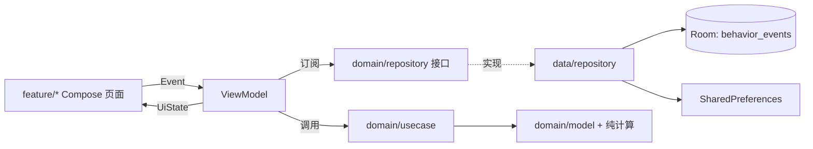

# 架构说明

> 目标读者：想改这个项目、或者只是想理解它怎么运转的人。

「飞了吗」是一个纯本地 Android 应用：记录一件事发生的时刻，然后从事件流里实时算出各种统计。本文说明代码分层、数据如何流动、以及几个特意做出的设计取舍。

## 总览



- 单 module（`:app`），按 feature 分包，没有为了分层而拆多 module。
- MVVM + 单向数据流：`UiState` 向下、事件向上。
- `domain` 只放纯 Kotlin，可被 JVM 单测直接覆盖；`data` 承载 Android 实现；`feature` 只做展示。

## 目录职责

| 目录 | 职责 |
| --- | --- |
| `core/ui/theme` | Material 3 主题、配色引擎、明暗模式 |
| `core/ui/components` | 通用组件：模糊、数字滚动、背景、取色器 |
| `core/navigation` | 顶部无 Scaffold 的状态驱动底栏与页面切换 |
| `data/local` | Room 数据库、DAO、Entity |
| `data/preferences` | 主题、布局、统计卡片设置（SharedPreferences + StateFlow） |
| `data/reminder` | 提醒偏好、AlarmManager 调度、通知与开机接收器 |
| `data/launcher` | 主题色一键切换桌面图标（activity-alias） |
| `domain/model` | `BehaviorEvent`、`StatsRange`、`StatsCard`/`CardSize`/`StatsLayout` 等 |
| `domain/usecase/stats` | `StatsCalculator`（全部统计口径）、`StatsGridPlacement`（卡片网格布局算法） |
| `domain/usecase/export` | `EventExporter` / `EventImporter`（CSV、JSON） |
| `feature/home` | 今日/本周、月历、最近记录 |
| `feature/history` | 时间线、补录、改时间、删除 |
| `feature/stats` | 指标卡、图表、卡片编辑模式 |
| `feature/settings` | 数据概况、导入导出、提醒、外观、隐私 |
| `feature/widget` | Glance 桌面小组件 |

## 数据模型：只存事件，不存计数

```
BehaviorType 1 ──── * BehaviorEvent
                   id / typeId / occurredAt / createdAt / note
```

- `behavior_events` 每行代表「一次发生」，`occurredAt` 是行为发生时间（可补录/修改），`createdAt` 是写入时间。
- 不建「每日次数」等派生表：好处是补录、改时间、删除都能自然地反映到所有统计里，不需要迁移历史数据；坏处是每次统计都要聚合，当前数据量（个人使用）完全可接受。
- 统计全部实时计算：`StatsCalculator.buildPage(events, now, zone, chartRange, metricRange)` 是纯函数，输入事件列表与时间，输出 `StatsPageData`。

## 统计口径（domain/usecase/stats/StatsCalculator.kt）

- 自然日按本地时区；周从周一开始。
- 日均 = 总次数 ÷ 从第一条记录到今天的自然日数（含空白日）；活跃日均 = 总次数 ÷ 有记录的天数。
- 连续天数：从今天（或昨天宽限）向前回溯。
- 平均间隔 / 间隔中位数：相邻事件时间差。
- 时段分布按小时、周内分布按星期。
- 趋势图按范围自动选粒度：近 7/30/90 天按天，全部范围按跨度选择按天/周/月；周桶按周一对齐并裁剪窗口。
- 箱线图（按周）：以「每周次数」为一个样本，窗口最多约半年（180 天），与「图表范围」解耦，避免短范围只剩 4–5 个样本。

## 统计卡片网格（domain/usecase/stats/StatsGridPlacement.kt）

统计页的卡片不是固定布局，而是一个 2 列网格：

- `StatsCard`（16 种：4 个图表 + 12 个指标）与 `StatsLayout(order, sizes, positions)` 描述顺序、尺寸、位置。
- 尺寸：`1×1`、`2×1`、`2×2`（占用 1 或 2 列、1 或 2 行）。
- 初始用 `computeGridSlots` 紧凑排布；用户拖动或改尺寸后保存 `positions`，允许出现空格。
- 改变尺寸时 `placeAfterResize` 尽量让卡片留在原位（与原位置至少重叠一格，左优先于右、上优先于下），只把真正被挡住的卡片按顺序往后让，缩小时后面的卡片可顺次上移补位。
- 拖动换位用 `withDragged`：被拖卡片占据目标锚点，挡路卡片往后让位，其余卡片不动；拖到空格则用 `withCardPosition`。
- 编辑模式的状态只在 StatsScreen 本地（`editing` + `draft`），点「完成」才写回 `StatsPreferences`。

## 主题引擎

- `ThemeMode`（跟随系统/浅色/深色）与 `ThemePalette`（7 个预设色）+ 自定义 HSV 颜色。
- `ColorSchemeFactory.buildColorScheme(seed, dark)` 根据主题色生成 Material 3 配色，并对 onPrimary/onSurface 等做 WCAG 对比度修正（`ensureContrast`），保证任何主题色下文字可读。
- 自定义背景：`AppBackground` 直接解码用户裁剪后的图片铺满，再盖一层 `background` 半透明遮罩保证可读；不申请存储权限，通过 SAF 选择图片。
- 桌面图标：`LauncherIconController` 在 8 个 `activity-alias` 之间切换（7 个预设色 + 1 个彩色），自定义色时使用彩色图标。

## 小组件与提醒

- `TodayWidget`（Glance）：读取今日次数，点击「＋」直接记录一次；应用内记录/撤销/补录/修改后会主动刷新所有小组件实例。
- 提醒：`ReminderPreferences` 保存开关与时间，`ReminderScheduler` 用 `AlarmManager.setAndAllowWhileIdle` 安排下一次；`ReminderReceiver` 发通知并安排下一次，`BootReceiver` 在开机后重排。
- 通知权限（Android 13+）按需申请；拒绝时提醒开关不可用。

## 导入 / 导出

- 导出：CSV（表头 `id,发生时间,记录时间,备注`）与 JSON（`app/formatVersion/exportedAt/count/events`），通过 SAF `CreateDocument` 写入用户选择的位置。
- 导入：自动识别 JSON / CSV（RFC 4180 解析，支持字段内逗号、引号、换行）；`id` 一律重新分配；按 `(occurredAt, createdAt, note)` 去重，跳过重复项；样式不合法条目计入「无法识别」。

## 测试策略

- JVM 单测（`src/test`）覆盖全部纯逻辑：统计、网格布局、裁剪几何、导入导出、提醒时间计算；Robolectric 会启动真实 `MainActivity` 做一次冒烟。
- instrumented 测试（`src/androidTest`）覆盖 Room DAO、无状态 Compose 页面与 MainActivity 启动，需要设备/模拟器。
- `tools/smoke.ps1` 用于真机安装冒烟（安装、启动、检查 `FATAL EXCEPTION`、截图）。

## 扩展点

1. **新增指标**：在 `StatsMetric` 加枚举 → `StatsCalculator` 计算字段 → `MetricCardContent` 渲染 → 自定义卡片对话框自动出现。
2. **新增图表**：在 `StatsCard`/`ChartsColumn` 加分发分支与一个 `ChartBody` 分支。
3. **新增统计范围**：在 `StatsRange` 加枚举，趋势粒度与指标窗口会自动适配。
4. **远端同步**：`BehaviorRepository` 已在 domain 抽象；新增 RemoteDataSource 与同步用例即可，UI 不需要改。

## 性能与取舍

- 数据量按「个人每天几十条、十年十万级」设计；聚合直接在 Room 查询 + Kotlin 内存计算，不建缓存表。
- 图表全部用 Compose Canvas 手绘，避免引入重型图表库；卡片入场动画用局部 `Animatable`，不阻塞滚动。
- 不追求多 module 拆分：当前规模下单 module 编译快、改动成本低。
